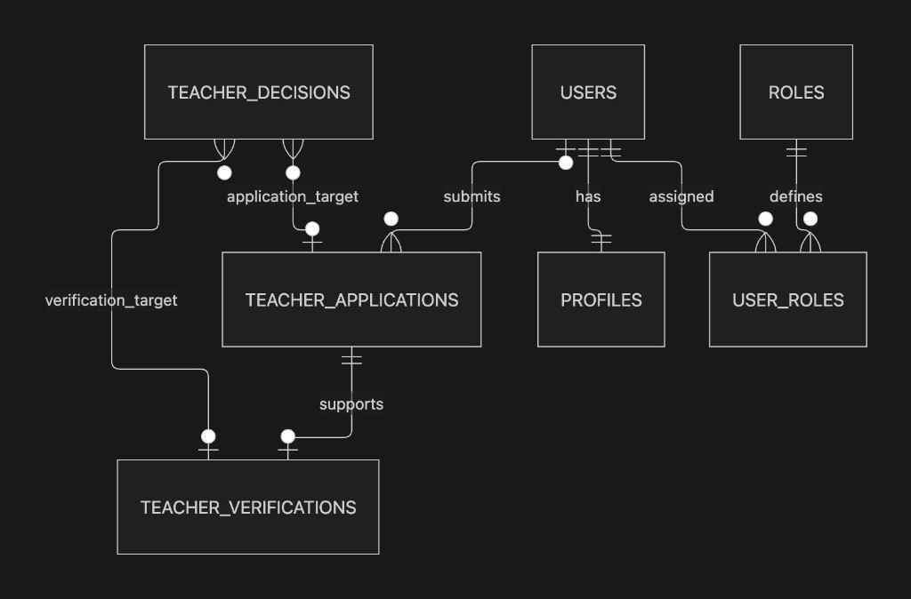
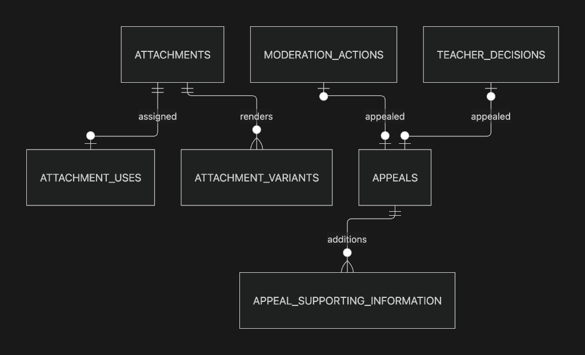
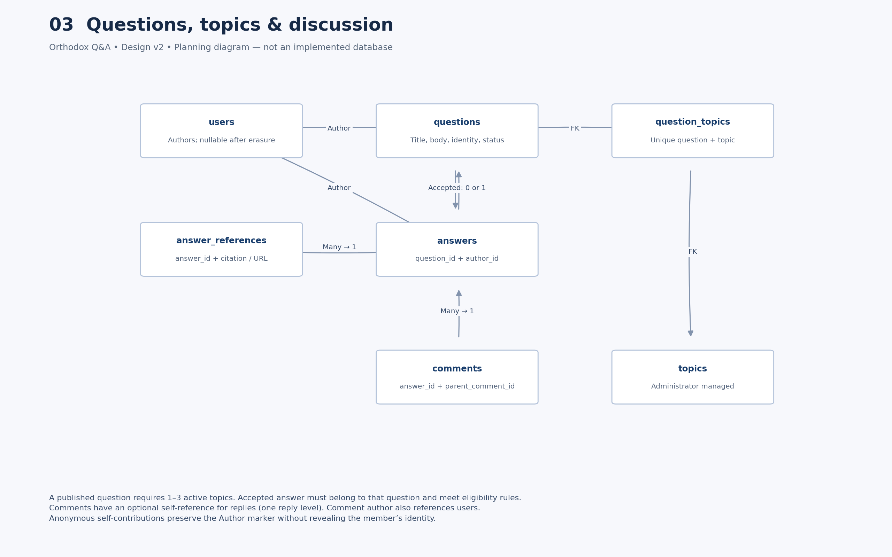
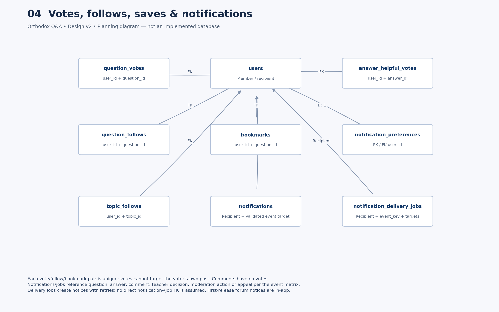
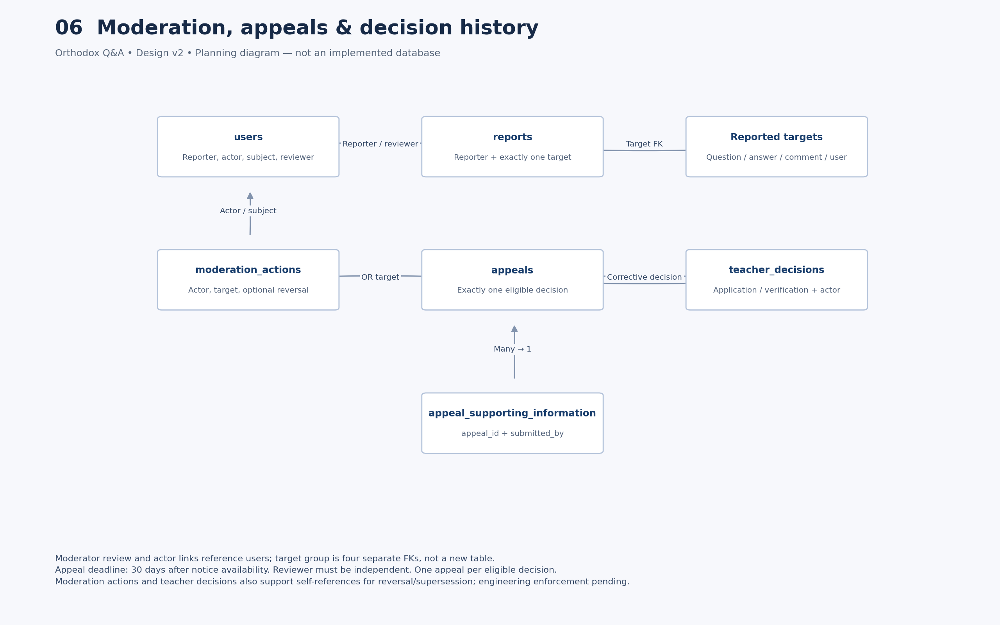

# Orthodox Q&A — database design diagrams

Architecture and ER diagrams for the forum data model. These illustrate the planning in [docs/Orthodox_QA_Database_Design_Reviewed_v2.md](../docs/Orthodox_QA_Database_Design_Reviewed_v2.md). They are **design references**, not an implemented live schema.

Application code and migrations remain under `backend/` / `frontend/`. This folder is documentation only.

Numbered prefixes keep review material and ERDs at the top of the file list on GitHub.

## Review document

- [00_DATABASE_ARCHITECTURE_REVIEW.pdf](00_DATABASE_ARCHITECTURE_REVIEW.pdf) — database architecture review (PDF)

## ER diagrams (01–02)

### 01 · Identity and teachers (ERD)

### 02 · Attachments and appeals (ERD)

## Architecture diagrams (03–08)

### 03 · System architecture

### 04 · Identity and teachers

### 05 · Questions and discussion

### 06 · Engagement and notifications

### 07 · Files and deletion

### 08 · Moderation and appeals

## Files

| File | Topic |
| --- | --- |
| [00_DATABASE_ARCHITECTURE_REVIEW.pdf](00_DATABASE_ARCHITECTURE_REVIEW.pdf) | Architecture review PDF |
| [diagrams/01_erd_identity_and_teachers.jpg](diagrams/01_erd_identity_and_teachers.jpg) | ERD — identity & teachers |
| [diagrams/02_erd_attachments_and_appeals.jpg](diagrams/02_erd_attachments_and_appeals.jpg) | ERD — attachments & appeals |
| [diagrams/03_system_architecture.png](diagrams/03_system_architecture.png) | System architecture |
| [diagrams/04_identity_and_teachers.png](diagrams/04_identity_and_teachers.png) | Identity and teachers |
| [diagrams/05_questions_and_discussion.png](diagrams/05_questions_and_discussion.png) | Questions and discussion |
| [diagrams/06_engagement_and_notifications.png](diagrams/06_engagement_and_notifications.png) | Engagement and notifications |
| [diagrams/07_files_and_deletion.png](diagrams/07_files_and_deletion.png) | Files and deletion |
| [diagrams/08_moderation_and_appeals.png](diagrams/08_moderation_and_appeals.png) | Moderation and appeals |

Also see: [API design](../docs/Orthodox_QA_API_Design.md), [architecture decisions](../docs/architecture/DECISIONS.md).
