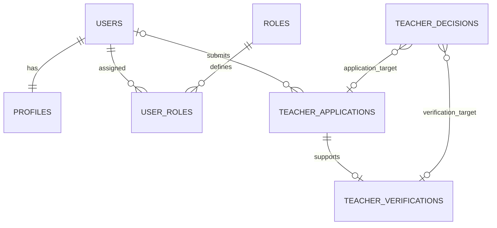
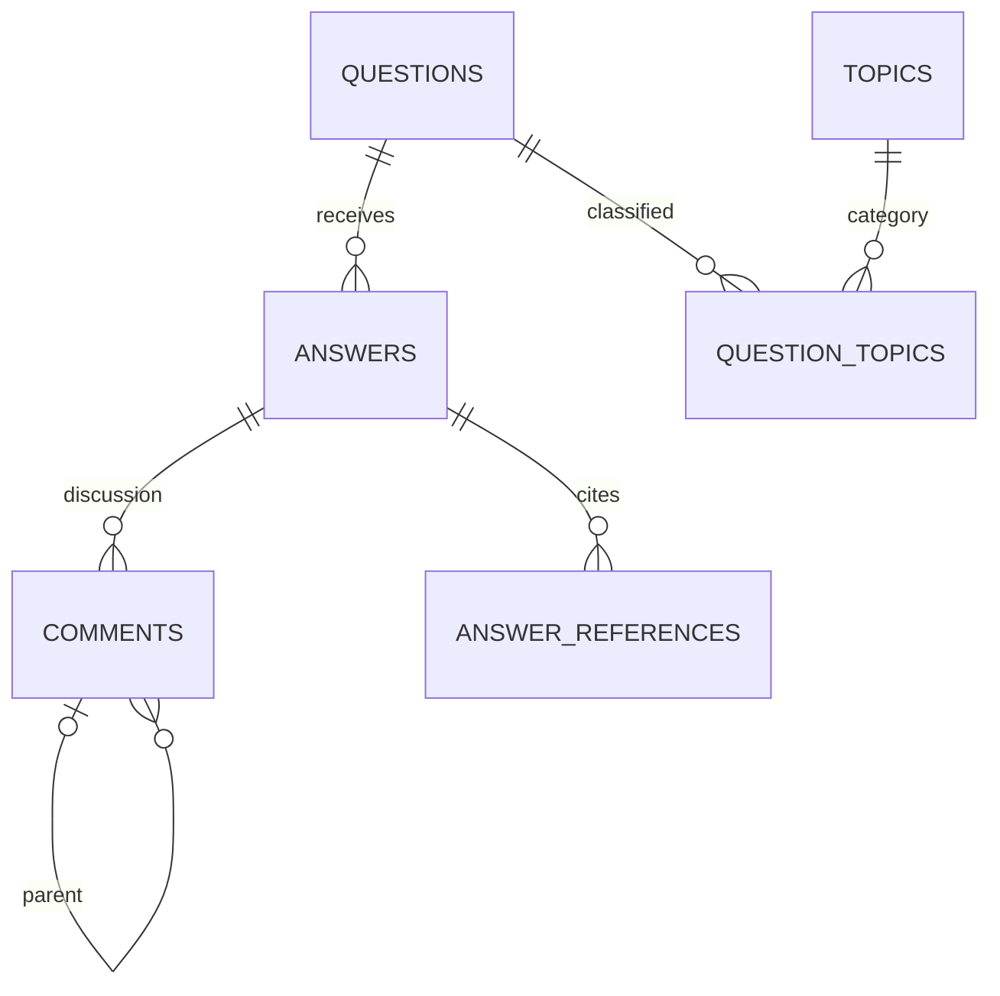
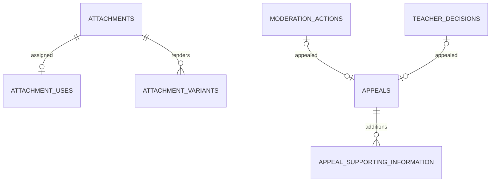

# Orthodox Q&A Forum — Consolidated Database Design

**Status: product decisions approved; technical review revision 2. Not approved for implementation.**

Product proposal group approved by the project owner on 20 October 2026. Engineering checks below are document-level review, not executed database tests.

This document replaces the accumulated schema notes. It preserves confirmed product decisions, combines the detailed field specifications, removes superseded alternatives, and identifies remaining review items. It does not modify Notion or any database.

## Architecture and scope

Next.js / React → Django → Supabase PostgreSQL, with Supabase Auth and Supabase Storage. Django owns forum authorization, moderation, privacy, and business rules. Supabase Auth owns credentials, verification, and recovery. Link identity using a unique UUID, never matching emails; no direct foreign key to `auth.users`.

Public reading requires no account. Participation requires verified email and applicable account permissions. Signup, verification-pending/resend/change-email, login, logout, and password recovery remain required. A normal login does not repeat email verification. Password-reset requests use a neutral confirmation. No passwords or Auth tokens belong in forum tables.

First release covers topics, questions, answers/references, comments/replies, upvotes/Helpful votes, follows, bookmarks, notifications, teacher verification, attachments, reports, moderation, and appeals. Reputation points, achievement scoring, star ratings, email digests, and push notifications remain outside first release.

## Reading this specification

UUIDs are primary identifiers; timestamps are timezone-aware. Required-at-creation foreign keys may be nullable in storage to support later account erasure; Django and documented cross-record checks enforce creation rules. SQL constraints and Django validation are complementary. A single field marked nullable does not permit bypassing creation rules.

The confirmed rules below take priority over technical proposals. Proposals stay labelled and are not silently approved. Exact trigger code, migrations, access policies, service providers, and deployment settings are outside this design deliverable.

## Confirmed product policies

### Identity and account deletion

- Each existing account has one profile and preferences record; new members receive Member role.
- Email is private and synchronized from trusted Auth information. Never accept browser claims of verification.
- Confirm verified email changes before updating the private forum copy. Reconcile identity and deletion changes reliably.
- Account deletion removes Auth identity, forum identity/profile/email, personal associations, recipient notices, profile photos, and private teacher evidence.
- Retained contributions detach from the account. Named authors display Deleted member; anonymous questions remain Anonymous. Stored question-author flags preserve anonymous self-answer/comment labels without retaining personal links.
- Never reattach ownership, roles, evidence, or activity to a new signup through matching email.
- Published text or images can themselves identify a person: detachment is not a guarantee of content anonymity. Apply the confirmed privacy-report/removal route to identifying content.
- Use deletion_pending during processing; completed erasure removes the user row. No identifying Deleted user account is retained.
- Teacher verification never grants moderator or administrator privileges. Anonymous self-answers hide teacher status and do not appear in teacher-only filtering.
- Identity defaults to named for each new question. Anonymous self-answers/comments/replies show Anonymous author with an Author badge. Changing posting identity after publication remains a product-review item.

### Staff Permissions — Confirmed
#### Moderators

- Can review reports, remove and restore content, warn ordinary members, and temporarily suspend ordinary members for up to 7 days.
- Can review eligible appeals only if they did not make the original decision.

#### Administrators

- Can perform moderation actions, apply longer or indefinite suspensions, approve and revoke teacher verification, create, edit, and archive topics, assign and revoke staff roles, and review eligible appeals only if they did not make the original decision.

#### Restrictions and Audit

- Apply the separation between teacher verification and staff roles when determining moderation permissions.
- Moderators cannot moderate staff accounts or their content, change staff permissions, or review appeals involving staff.
- Teacher-verification appeals require an administrator; staff-related appeals require another administrator.
- Nobody can decide an appeal against their own action. If no independent reviewer is available, leave it pending for escalation.
- Moderators cannot extend or repeatedly renew suspensions to bypass the 7-day limit; escalate longer restrictions to administrators.
- Record all moderation decisions and staff-role changes in audit history, then apply the confirmed retention periods.
- Enforce permissions in Django, including direct API requests.

### Appeal Rules — Confirmed
- Members can appeal content removal, warnings, suspensions, teacher-application rejection, and teacher-verification revocation.
- Each appeal must target exactly one decision: a moderation action, a teacher-application rejection, or a teacher-verification revocation.
- Allow one appeal per member per decision, including after the appeal is closed; prevent any duplicate appeal against that decision.
- Members can see their own appeal and decision, with a clear explanation, but not private staff notes or reporter identities.
- Members can add supporting information while an appeal is Pending or In Review; record each addition in appeal_supporting_information without overwriting prior submissions.
- The original decision-maker cannot review their own decision. Apply the confirmed staff permissions: teacher-verification and staff-related appeals require an independent administrator. If no eligible independent reviewer is available, leave the appeal Pending for escalation.
- Appeal submission does not automatically reverse the original decision. If approved, record any reversal as a new action and preserve the original decision and audit history for the applicable retention period.
- The submission deadline is 30 days after the decision notice becomes available to the member; record both the notice-availability time and submission deadline.
- Suspended members retain access to their own notices and appeal flow.

### Upload Limits — Confirmed
| Upload type | File limit | Maximum size per file | Allowed formats |
| --- | --- | --- | --- |
| Question images | 5 per question | 5 MB | JPG, PNG, WebP |
| Answer images | 3 per answer | 5 MB | JPG, PNG, WebP |
| Profile photo | 1 per profile | 2 MB | JPG, PNG, WebP |
| Teacher-verification evidence | 5 per application | 10 MB | PDF, JPG, PNG |
- Comments and replies are text only.
- Validate actual file type, size, and image dimensions on the server.
- Optimize public images and remove unnecessary metadata.
- Teacher evidence remains private, accessible only to the applicant and authorized reviewers.
- Display clear errors when uploads exceed these limits.
- Enforce these limits in Django and storage upload controls.

### Remaining Retention Periods — Confirmed
| Record | Retention |
| --- | --- |
| Ordinary in-site notifications | Delete after 90 days. |
| Abandoned uploads | Delete after 24 hours only if not attached to a submitted post, profile, or teacher application. |
| Reports and appeals | Retain for 2 years after closure. |
| Moderation decisions | Retain while a restriction is active, then for 2 years after it ends. Without an ongoing restriction, retain for 2 years after case closure. |
| Staff-role change history | Retain for 2 years after each change; expiring history must not remove current role assignments. |
| Important account notices | Keep accessible while the related decision or appeal record is retained; they do not expire with ordinary notifications. |
| Teacher-verification evidence | Keep the existing confirmed policy: no automatic expiry while the account exists; delete when the account is deleted (see the corresponding named specification below). |
- Preserve decision records needed by an open appeal or active restriction until those processes finish, then apply the relevant retention period.
- Minimize retained private moderation records; never reconnect a new account through a matching email.
- Backup provider, cost, implementation details, and genuinely unspecified retention periods remain open; confirmed periods above are not reopened.

### Backup and Deletion Recovery — Confirmed
- Require daily backups with a 30-day retention period.
- Cover both PostgreSQL data and Supabase Storage files in the recovery plan; do not assume database backups include uploaded files.
- Deleted information may remain in restricted backups until those backups expire.
- Maintain a minimal deletion log, separate from the restored backup, so account and file deletions can be reapplied after recovery.
- Do not store deleted emails, document contents, or other unnecessary personal data in that log.
- Before reopening a restored system, reapply deletions and verify that deleted accounts, private evidence, and files have not reappeared.
- Retain deletion-log entries until all backups capable of restoring the deleted data have expired.
- Restrict backup access to authorized operators and test recovery before launch.
- Backup provider, implementation, and cost remain undecided.

### Text Length Limits — Confirmed
| Field | Minimum | Maximum |
| --- | --- | --- |
| Question title | 10 characters | 200 characters |
| Question details | Optional | 10,000 characters |
| Answer | 10 characters | 20,000 characters |
| Comment or reply | 1 character | 2,000 characters |
| Display name | 2 characters | 50 characters |
| Profile biography | Optional | 500 characters |
- Trim surrounding whitespace before validation.
- Count visible text, excluding formatting markup.
- Use consistent Unicode-aware counting for Amharic and English.
- Required fields cannot contain only whitespace or empty formatting.
- Enforce limits in Django and show matching validation and character counters in the frontend.
- Show clear errors without losing the user’s draft.

### Post Images After Account Deletion — Confirmed
- Images attached to retained questions and answers remain after account deletion.
- Remove their connection to the deleted uploader’s account.
- Images follow the parent post’s visibility and moderation rules.
- Profile photos and private teacher evidence are deleted.
- Explain before deletion that published posts and their images remain.
- Never reconnect retained posts or images to a new account using the same email.

### Content Restoration — Confirmed
- Removing a question hides its answers, comments, replies, and attached images from public view without changing their individual statuses.
- Restoring the question makes its still-published discussion visible again.
- Separately removed or deleted answers, comments, replies, and images remain hidden.
- Removing and restoring an answer follows the same rule for its comments, replies, and images.
- Restoring content does not automatically restore a previously cleared “Answered my question” selection.
- Apply these visibility rules consistently to pages, search, feeds, counts, notifications, and attachment access.

### Accepted Answer After Account Deletion — Confirmed
- Keep the existing “Answered my question” selection when the question author deletes their account, provided the selected answer remains published.
- Display the deleted author according to the confirmed identity rules.
- A new account cannot inherit ownership or change that selection, even if registered with the same email.
- Clear the selection if the selected answer is removed or deleted.
- Keeping this selection does not indicate official Church approval.

### Votes After Account Deletion — Confirmed
- Delete the member’s question upvotes and answer Helpful votes when their account is deleted.
- Update affected vote totals, including any cached counts.
- Keep other members’ votes on the deleted author’s retained posts.
- A new account does not inherit the deleted account’s voting history.

### Archived Topics During Question Editing — Confirmed
- Existing questions may retain topics that administrators later archive.
- Authors may remove archived topics while editing.
- Archived topics cannot be newly added or added back after removal.
- Each question must retain **1–3 topics in total**, counting existing archived topics.
- Any newly added topic must be active.
- Saving the question and its topic changes happens together, so invalid changes do not partially save.

### Permanent Content Deletion — Confirmed
- Members can request deletion of their own content.
- Moderators normally remove content from public view without permanently erasing it.
- Only administrators can authorize permanent deletion.
- Permanent deletion erases the target’s text and associated files, subject to documented retention holds and backup expiry.
- Preserve a minimal “Question deleted,” “Answer deleted,” or “Comment deleted” placeholder when needed to retain other members’ contributions and thread relationships.
- Do not automatically delete other people’s answers, comments, or replies.
- Clear any accepted-answer selection pointing to a permanently deleted answer.
- Personal information in content or images can be reported for privacy review and removal.
- Record the deletion decision without copying erased personal content into audit notes.
- Account deletion continues to follow the separate, confirmed discussion-retention policy.

**Visibility clarification:** Unlike temporary moderation removal, a permanently deleted question or answer may retain a public placeholder with surviving discussion. Separately removed or deleted descendants remain hidden or redacted.

### Teacher Records After Account Deletion — Confirmed
- Delete private teacher evidence and personal application details when the account is deleted.
- Remove identifying links to the deleted applicant.
- Keep only minimal decision records needed for an existing appeal or the confirmed audit-retention period.
- Retained records may contain decision type, status, dates, and a non-identifying reason category.
- Remove names, emails, document contents, and identifying free text.
- Delete remaining decision records when their applicable retention period ends.
- Never reconnect these records or restore teacher status to a new account using the same email.
- This does not change the rule that teacher evidence has no automatic expiry while the account exists.

### Personal Details in Retained Records — Confirmed
- On account deletion, review retained application text, reports, appeals, moderation notes, and staff-role reasons for identifying information about the deleted member.
- Remove or redact names, emails, phone numbers, and other identifying details.
- Keep only the decision, dates, reason category, and non-identifying explanation needed under the confirmed retention rules.
- Removing an account link alone is not sufficient if free text still identifies the member.
- Do not copy removed personal information into audit logs or deletion logs.
- Apply the same redactions after backup restoration before reopening the system.
- Never use retained records to reconnect a new account through a matching email.

### Email Notifications — Confirmed First-Release Scope
- Supabase Auth manages email verification and password-reset emails.
- Answers, replies, teacher decisions, moderation notices, and appeal decisions are delivered inside the website.
- Email copies of these forum notifications are outside the first release.
- Important in-site notices remain mandatory; ordinary answer and reply notifications follow member preferences.
- A production email-delivery provider for authentication emails still needs to be configured.

### Answer Reference Limits — Confirmed
- References are optional, with a maximum of **10 per answer**.
- Each reference requires a source title, up to **200 characters**.
- Include citation details, up to **1,000 characters**, or a website link—or both.
- Links are optional, up to **2,048 characters**, and must use `https://` or `http://`.
- Preserve the author’s chosen reference order.
- Reject blank required fields and unsafe link schemes.
- Apply the same text-counting rules already confirmed for Amharic and English.
- Enforce limits in Django and show matching frontend validation.

### Image Dimensions — Design Specification
- Accept images up to **8,000 pixels on either side**, with a maximum of **25 million pixels total**.
- Validate dimensions before fully processing the image.
- Resize public question and answer images to a maximum of **2,048 pixels on their longest side**, preserving proportions.
- Create smaller thumbnails for feeds and cards.
- Profile photos use a square crop up to **512 × 512 pixels**, without enlarging smaller sources.
- Never enlarge small images automatically.
- Keep private teacher evidence at its accepted original resolution.
- Existing file-size and format limits still apply.
- Reject unsupported, corrupted, or oversized images with a clear message.

## Detailed Table Specifications

## Accounts, Profiles, and Roles

This section specifies the account tables. It does not create them.

**Notation:** UUID means a unique identifier. Nullable means the field may be empty. All timestamps use timezone-aware PostgreSQL `timestamptz`.

### Users

| Field | Type | Required / default |
| --- | --- | --- |
| id | UUID | Primary key |
| supabase_user_id | UUID | Required, unique; no direct Auth foreign key |
| email | Text | Required, private synchronized copy |
| email_verified_at | Timestamp | Nullable until verified |
| status | Text | Required; default `active` |
| created_at | Timestamp | Required; creation time |
| updated_at | Timestamp | Required; latest update time |
- Allowed statuses: `active`, `suspended`, `deactivated`, `deletion_pending`.
- Verification is separate from account status: an active but unverified account cannot participate.
- `deletion_pending` blocks participation while account deletion is processed.
- Completed deletion removes the user row; do not retain an identifying “Deleted” account.
- Supabase remains authoritative for email and verification.
- Do not use email to reconnect deleted contributions.
- Suspension details belong to moderation records; Django keeps effective account restrictions consistent with them.

### Profiles

| Field | Type | Required / default |
| --- | --- | --- |
| user_id | UUID | Primary key and foreign key to users |
| display_name | Text | Required; 2–50 characters |
| biography | Text | Default empty; maximum 500 characters |
| preferred_language | Text | Required; `am` or `en` |
| created_at | Timestamp | Required |
| updated_at | Timestamp | Required |
- Create the user, profile, Member role assignment, and notification preferences together in one transaction.
- Use the language selected during signup; if absent, use English.
- Display names are not unique.
- Delete the profile when deleting its user.
- Profile photos are linked through the agreed unified attachment-use structure. Do not also maintain a competing `avatar_attachment_id` relationship.

### Roles

| Field | Type | Required / default |
| --- | --- | --- |
| id | UUID | Primary key |
| code | Text | Required, unique |
- Allowed codes: `member`, `moderator`, `administrator`.
- Teacher verification is separate.
- Keep role definitions; prevent deletion while referenced.

### Current Role Assignments

| Field | Type | Required / default |
| --- | --- | --- |
| id | UUID | Primary key |
| user_id | UUID | Required foreign key to users |
| role_id | UUID | Required foreign key to roles |
| assigned_by | UUID | Nullable foreign key to users |
| assigned_at | Timestamp | Required |
- Unique constraint on `(user_id, role_id)`.
- `assigned_by` may be empty for automatic Member assignment or after the assigning administrator is deleted.
- Delete assignments when the affected account is deleted.
- Deleting an assigning administrator must not remove other members’ current roles.
- Record staff grants and revocations separately in staff-role audit history.
- Django enforces who can assign or revoke roles.

## Staff-Role Audit History

### Table: `staff_role_audit`

| Field | Type | Required / default |
| --- | --- | --- |
| id | UUID | Primary key |
| target_user_id | UUID | Foreign key to users; nullable after account deletion |
| role_id | UUID | Required foreign key to roles |
| changed_by | UUID | Foreign key to users; nullable after account deletion |
| action | Text | Required: `granted` or `revoked` |
| reason_code | Text | Required reason category |
| reason | Text | Optional private explanation |
| created_at | Timestamp | Required; event time |

### Rules and Constraints

- Record every moderator or administrator role grant and revocation.
- Require an existing actor and affected member when recording the event.
- Only administrators can change staff roles.
- Save the role change and audit event together in one database transaction.
- Keep historical events when a current role assignment is revoked.
- Do not overwrite past events to represent later changes.
- Privacy redaction and scheduled retention cleanup are permitted exceptions to immutable history.
- On account deletion, set the affected user links to null and redact identifying free text.
- Keep the role definition while audit records reference it.
- Retain each event for **2 years after the change**, subject to an applicable open-case hold.
- Restrict this history to administrators.
- Index `(target_user_id, created_at)` and `(changed_by, created_at)`.
- Use timezone-aware timestamps.

## Teacher Applications

### Table: `teacher_applications`

| Field | Type | Rules |
| --- | --- | --- |
| id | UUID | Primary key |
| applicant_id | UUID | Required on submission; nullable after erasure |
| application_details | Text | Private; required at submission, redacted on erasure |
| status | Text | pending, approved, rejected, withdrawn; default pending |
| current_decision_id | UUID | Nullable FK to teacher_decisions; same application |
| withdrawn_at | Timestamp | Required only for withdrawn state |
| created_at | Timestamp | Required |
| updated_at | Timestamp | Required |

- Partial unique applicant index for pending applications; no application by an already actively verified member.
- Applicant may withdraw a pending application. Administrators decide approval/rejection.
- Use the teacher_decisions table below for reviewer, time, explanations, internal notes, and notice availability. Do not duplicate conflicting decision fields here.
- Approval, decision, verification creation, and delivery-work recording are transactional. Rejected applications create no verification.
- Maximum five private evidence files through attachment_uses. Applicants cannot read internal staff notes.
- Index applicant/creation time and status/creation time. Privacy and retention follow confirmed policies; the unappealed teacher-decision retention period remains a proposal below.

## Teacher Verification

### Table: `teacher_verifications`

| Field | Type | Rules |
| --- | --- | --- |
| id | UUID | Primary key |
| user_id | UUID | Required at approval; nullable after erasure |
| application_id | UUID | Required unique FK to approved application |
| approved_by | UUID | Required at approval; nullable after actor erasure |
| approved_at | Timestamp | Required original approval time |
| current_decision_id | UUID | Nullable during insertion; required at transaction commit for retained verification; FK to teacher_decisions |
| ended_at | Timestamp | Nullable while currently active |
| end_reason | Text | Null, revoked, or account_deleted |

- Active means user exists and ended_at is null. Enforce at most one active verification per non-null user.
- Application and verification ownership must match; enforce in Django and cross-record database constraints.
- Revocation sets ended_at and end_reason and appends a teacher decision. Reinstatement after an approved appeal may clear this current end state, preserving all earlier decisions.
- Historical revocation fields are stored in teacher_decisions, not overwritten on this row. This replaces earlier revoked_at/revoked_by/revocation-explanation summary fields.
- Account deletion ends verification before detaching the user. Never reinstate onto a replacement account.
- Public badges and teacher-only results derive from current state, with the anonymity exception above.
- Keep verification/application rows while retained decisions or appeals need them. Their deletion order follows dependency and retention checks.
- Index user/approval time and the partial active-user uniqueness constraint.

## Topics

### Table: `topics`

| Field | Type | Required / default |
| --- | --- | --- |
| id | UUID | Primary key |
| slug | Text | Required, unique, stable URL identifier |
| name_en | Text | Required English name |
| name_am | Text | Required Amharic name |
| description_en | Text | Optional; default empty |
| description_am | Text | Optional; default empty |
| is_active | Boolean | Required; default `true` |
| created_at | Timestamp | Required |
| updated_at | Timestamp | Required |

### Table: `question_topics`

| Field | Type | Required / default |
| --- | --- | --- |
| id | UUID | Primary key |
| question_id | UUID | Required foreign key to questions |
| topic_id | UUID | Required foreign key to topics |

### Rules and Constraints

- Only administrators create, edit, or archive topics.
- Topic names are categories such as Prayer, Bible, Fasting, and Liturgy—not question titles.
- Enforce a unique `(question_id, topic_id)` association.
- New questions require **1–3 active topics**.
- Existing questions may keep archived topics.
- Authors can remove archived associations but cannot add them back.
- Edited questions must retain **1–3 topics in total**, including retained archived topics.
- Validate and save question/topic changes in one transaction. Serialize simultaneous edits to prevent bypassing the limit.
- Archive topics rather than deleting referenced topic records.
- Topic editing must not silently change its meaning and miscategorize existing questions.
- Index `(topic_id, question_id)` for topic filtering.
- Preserve topic associations for retained discussions and deletion placeholders unless a documented cleanup rule requires removal.

### Approved Field Limits

- Slug: maximum 100 characters; lowercase Latin letters, numbers, and hyphens.
- Names: 1–100 characters each.
- Descriptions: maximum 1,000 characters each.
- Apply the agreed Unicode-aware text validation.
- These limits are approved.

## Questions

### Table: `questions`

| Field | Type | Required / default |
| --- | --- | --- |
| id | UUID | Primary key |
| author_id | UUID | Foreign key to users; nullable after account deletion |
| title | Text | Required when published; 10–200 characters |
| body | Text | Optional; default empty; maximum 10,000 characters |
| is_anonymous | Boolean | Required; default `false` |
| status | Text | Required; `published`, `removed`, or `deleted` |
| accepted_answer_id | UUID | Nullable foreign key to answers |
| created_at | Timestamp | Required |
| updated_at | Timestamp | Required |
| edited_at | Timestamp | Nullable until author edits content |
| deleted_at | Timestamp | Nullable until permanent content deletion |

### Ownership and Identity

- Require an existing, verified-email member with permission to participate when creating a question.
- Posting by name is the default for every new question.
- Anonymous questions retain ownership internally while the account exists.
- Never expose anonymous ownership through public responses, profiles, notifications, or attachment metadata.
- Account deletion sets `author_id` to null without deleting the question.
- Named questions then display **Deleted member**; anonymous questions remain **Anonymous**.
- Retained questions cannot be claimed by a new account.

### Topics and Following

- Use the question_topics specification above.
- Create the question, its topic associations, and the author’s automatic follow together in one transaction.
- Apply the confirmed topic rules when publishing or editing.
- The author can subsequently unfollow.

### Accepted Answer

- Selection is optional.
- The selected answer must belong to this question, remain published, and not be the author’s own answer.
- Only the question author can select, replace, or clear it.
- Enforce the same-question relationship with a database constraint or constraint trigger; Django also validates permissions and eligibility.
- Clear the selection when the selected answer is removed or deleted.
- Keep an existing selection when the question author deletes their account.
- Restoration does not automatically reinstate a cleared selection.

### Visibility and Deletion

- Removing a question hides its discussion without overwriting descendants’ individual statuses.
- Restoring it reveals only descendants allowed by the confirmed visibility rules.
- Permanent deletion erases the title, body, and associated question images, subject to documented retention holds and backup expiry.
- Permit empty title/body for a permanently deleted placeholder; show **Question deleted** as a generated interface label.
- A deleted placeholder may preserve surviving discussion.
- Account deletion alone does not erase question text or attached images.
- Moderation decisions are recorded separately.

### Constraints and Indexes

- Validate allowed status values.
- Require a nonempty, valid-length title for published or temporarily removed questions; permanent-deletion placeholders are exempt.
- Require `deleted_at` for permanently deleted questions.
- Index `(status, created_at, id)` for chronological feeds.
- Index `(author_id, created_at, id)` for ownership queries; public profile results must still exclude anonymous activity.
- Do not store answer, vote, or follower totals as authoritative fields here; derive them from their records initially.
- Specify search indexing separately, including Amharic and English behavior.

### Review Note

The named/anonymous choice is locked after publication. Exceptional privacy requests go through authorized moderation; do not expose a public identity-switch action.

## Answers and References

### Table: `answers`

| Field | Type | Required / default |
| --- | --- | --- |
| id | UUID | Primary key |
| question_id | UUID | Required foreign key to questions |
| author_id | UUID | Foreign key to users; nullable after account deletion |
| is_question_author | Boolean | Required; calculated by Django on creation |
| body | Text | Required before deletion; 10–20,000 characters |
| status | Text | Required; `published`, `removed`, or `deleted` |
| created_at | Timestamp | Required |
| updated_at | Timestamp | Required |
| edited_at | Timestamp | Nullable until author edits content |
| deleted_at | Timestamp | Nullable until permanent content deletion |

### Answer Rules

- Require a verified-email member with permission to participate when posting.
- Each answer belongs to exactly one question; it cannot be moved to another question.
- Do not allow new answers on removed or deleted questions.
- Members may answer their own questions.
- Django sets `is_question_author` by comparing authenticated ownership. Never trust a browser-supplied value.
- Preserve this flag after account deletion so Author badges and anonymous self-answer identity remain correct.
- On an anonymous question, self-answers display **Anonymous author**, with no identifying profile link or teacher badge.
- Other answers display the author’s name and current teacher badge where applicable.
- Members cannot vote on their own answers or accept their own self-answer.
- Members can edit their own answers; show an Edited label.
- Account deletion detaches `author_id` but retains the answer and its images.
- Named deleted authors display **Deleted member**.
- Anonymous self-answers retain their anonymous Author label.
- Teacher-only filtering must exclude anonymous self-answers whose teacher status is intentionally hidden.

### Visibility and Deletion

- An answer’s public visibility depends on its own status and the parent question’s visibility rules.
- Removing an answer hides its comments, replies, and images without overwriting their individual statuses.
- Permanent deletion erases its body, references, and answer images, subject to documented retention holds.
- Preserve a minimal placeholder when needed for surviving comments or replies.
- Clear any accepted-answer selection pointing to a removed or deleted answer.
- Allow an empty body only for a permanently deleted placeholder.
- Require `deleted_at` when status is `deleted`.

### Table: `answer_references`

| Field | Type | Required / default |
| --- | --- | --- |
| id | UUID | Primary key |
| answer_id | UUID | Required foreign key to answers |
| source_title | Text | Required; maximum 200 characters |
| citation_text | Text | Default empty; maximum 1,000 characters |
| url | Text | Default empty; maximum 2,048 characters |
| position | Integer | Required; 1–10 |

### Reference Rules

- References are optional, with a maximum of 10 per answer.
- Each reference requires a source title and either citation text or a URL, or both.
- Allow only HTTP and HTTPS links.
- Enforce unique `(answer_id, position)` and positions from 1–10.
- Save answer and reference edits together in one transaction.
- References inherit the answer’s visibility.
- Remove references when permanently erasing the answer’s content.
- Apply the confirmed text-counting and safe-rendering rules.

### Constraints and Indexes

- Index answers by `(question_id, status, created_at, id)`.
- Index `(author_id, created_at, id)` for ownership queries.
- Prevent deletion of a question row while surviving answers reference it; use the agreed placeholder approach.
- Enforce self-author flag consistency at creation in Django and with a database trigger where practical.
- Preserve ownership-derived flags during later account detachment.
- Use timezone-aware timestamps.

## Comments and Replies

### Table: `comments`

Comments and replies share one table.

| Field | Type | Required / default |
| --- | --- | --- |
| id | UUID | Primary key |
| answer_id | UUID | Required foreign key to answers |
| author_id | UUID | Foreign key to users; nullable after account deletion |
| parent_comment_id | UUID | Nullable foreign key to comments |
| is_question_author | Boolean | Required; calculated by Django on creation |
| body | Text | Required before deletion; 1–2,000 characters |
| status | Text | Required; `published`, `removed`, or `deleted` |
| created_at | Timestamp | Required |
| updated_at | Timestamp | Required |
| edited_at | Timestamp | Nullable until author edits content |
| deleted_at | Timestamp | Nullable until permanent content deletion |

### Thread Relationships

- A top-level comment has no `parent_comment_id`.
- A reply points to a top-level comment on the same answer.
- Allow one reply level only.
- Prevent self-parenting, cycles, cross-answer replies, and replies beneath other replies.
- Do not allow comments or replies to be moved between answers or threads.
- Use a database constraint trigger for cross-record thread rules; Django validates them too.
- Prevent physical deletion of a parent row while surviving replies reference it.

### Posting and Editing

- Require a verified-email member with permission to participate.
- Allow new comments only when the question and answer are published.
- Allow new replies only when the parent comment is also published.
- Existing published replies may remain beneath a removed-comment placeholder.
- Comments and replies are text only; no attachments.
- Members may edit their own comments and replies.
- Display an Edited label after an author edit.
- Replies notify the parent comment’s author according to their preferences, excluding self-notifications.

### Author Identity

- Calculate `is_question_author` from the answer’s parent question and authenticated ownership.
- Never accept this flag directly from the browser.
- On a named question, the question author displays their name and Author badge.
- On an anonymous question, they display **Anonymous author** and Author badge, without a profile link or teacher badge.
- Preserve this marker after account deletion.
- Other deleted authors display **Deleted member**.
- Apply identity protection to public pages, profile activity, notifications, search, and API responses.

### Visibility and Deletion

- Apply the parent question and answer visibility rules before displaying a comment.
- Removed comment text remains hidden; a placeholder may preserve its thread.
- Permanent deletion erases the body, subject to documented retention holds.
- Permit an empty body only for a permanently deleted placeholder.
- Require `deleted_at` when status is `deleted`.
- Account deletion sets `author_id` to null without deleting the contribution.
- Restoration does not restore separately removed or deleted replies.

### Constraints and Indexes

- Validate allowed status values and text limits.
- Enforce `parent_comment_id != id`.
- Index `(answer_id, parent_comment_id, created_at, id)` for thread loading.
- Index `(author_id, created_at, id)` for ownership queries.
- Count published top-level comments and published replies separately, subject to parent visibility.
- Use timezone-aware timestamps.

## Question Upvotes and Answer Helpful Votes

### Table: `question_votes`

| Field | Type | Required / default |
| --- | --- | --- |
| id | UUID | Primary key |
| question_id | UUID | Required foreign key to questions |
| user_id | UUID | Required foreign key to users |
| created_at | Timestamp | Required |

### Table: `answer_helpful_votes`

| Field | Type | Required / default |
| --- | --- | --- |
| id | UUID | Primary key |
| answer_id | UUID | Required foreign key to answers |
| user_id | UUID | Required foreign key to users |
| created_at | Timestamp | Required |

### Voting Rules

- Require a verified-email member with permission to participate.
- Allow one upvote per member per question.
- Allow one Helpful vote per member per answer.
- Members cannot vote on their own contributions.
- Allow adding votes only when the target and its parent question are publicly available.
- Members can undo their existing votes, subject to account restrictions.
- Undoing a vote deletes its record.
- Retried voting requests must not create duplicates or accidentally toggle a vote.
- Question upvotes and answer Helpful votes are separate; neither indicates official Church approval.
- Do not add downvotes, star ratings, or reputation points in this release.

### Constraints and Enforcement

- Unique constraint on `(question_id, user_id)`.
- Unique constraint on `(answer_id, user_id)`.
- PostgreSQL enforces foreign keys and uniqueness.
- Django enforces permissions, visibility, and self-voting restrictions.
- Use a database trigger for self-voting protection where practical.
- Adding and removing votes must remain correct under simultaneous requests.
- Use timezone-aware timestamps.

### Deletion and Counts

- Delete a member’s votes when their account is deleted.
- Keep other members’ votes on a deleted author’s retained contributions.
- Temporarily removing content preserves its vote records but hides the content and its public totals.
- **Confirmed cleanup rule:** permanently erasing a contribution also deletes votes targeting it; retain no vote total on its placeholder.
- Derive totals from vote records initially. Any future cached totals must update reliably.
- Index `user_id` in both tables for account-deletion cleanup.
- The unique target/member indexes support vote counting and duplicate checks.

## Following and Saved Questions

### Table: `topic_follows`

| Field | Type | Required / default |
| --- | --- | --- |
| id | UUID | Primary key |
| user_id | UUID | Required foreign key to users |
| topic_id | UUID | Required foreign key to topics |
| created_at | Timestamp | Required |

### Table: `question_follows`

| Field | Type | Required / default |
| --- | --- | --- |
| id | UUID | Primary key |
| user_id | UUID | Required foreign key to users |
| question_id | UUID | Required foreign key to questions |
| created_at | Timestamp | Required |

### Table: `bookmarks`

| Field | Type | Required / default |
| --- | --- | --- |
| id | UUID | Primary key |
| user_id | UUID | Required foreign key to users |
| question_id | UUID | Required foreign key to questions |
| created_at | Timestamp | Required |

### Rules and Constraints

- Require a verified-email member with permission to participate when adding follows or bookmarks.
- Unique `(user_id, topic_id)` in `topic_follows`.
- Unique `(user_id, question_id)` separately in `question_follows` and `bookmarks`.
- Retried add/remove requests must be safe and must not toggle the action unexpectedly.
- Following and saving are independent actions.
- Automatically follow a newly posted question for its author, in the question-creation transaction.
- Authors can later unfollow their questions.
- Topic follows personalize the Following feed without notifying members about every new question.
- Question follows enable new-answer notifications, subject to preferences.
- Saved-question lists and individual follow lists remain private.
- Public question follower counts reflect current follow records.
- Django applies visibility rules to every returned question.

### Archiving, Removal, and Deletion

- Existing follows of archived topics remain, with an Archived label.
- **Confirmed rule:** prevent new follows of archived topics; allow unfollowing.
- Prevent new follows or bookmarks on removed or deleted questions.
- Existing associations do not reveal removed content or erased text.
- Members can remove their own follows and bookmarks, subject to account restrictions.
- Account deletion removes all three types of personal association.
- **Confirmed cleanup rule:** permanent question deletion removes its follows and bookmarks; temporary removal preserves them.
- Never transfer associations to a new account using a matching email.

### Indexes

- Add `(topic_id, user_id)` for topic-follower lookup.
- Add `(question_id, user_id)` to `question_follows` for notifications and follower counts.
- The unique user/target indexes support personal lists and duplicate prevention.
- Use timezone-aware timestamps.

## Notification Preferences

### Table: `notification_preferences`

| Field | Type | Required / default |
| --- | --- | --- |
| user_id | UUID | Primary key and foreign key to users |
| new_answers | Boolean | Required; default `true` |
| comment_replies | Boolean | Required; default `true` |
| created_at | Timestamp | Required |
| updated_at | Timestamp | Required |

### Rules and Constraints

- Each existing forum member has exactly one preferences record.
- Create it alongside the user, profile, and Member role assignment.
- Members can read and change only their own preferences.
- `new_answers` controls ordinary notifications about new answers to followed questions.
- `comment_replies` controls ordinary notifications about replies to the member’s comments.
- Important account, teacher-verification, moderation, and appeal notices cannot be disabled.
- Do not add an optional teacher-decision setting.
- Preference changes affect future notification creation; they do not delete existing notifications.
- Recheck the relevant preference when processing an ordinary notification for delivery.
- Delete the preferences record when its user account is deleted.
- A new account receives fresh defaults and does not inherit deleted preferences.
- These settings cover in-site notifications only.
- Use timezone-aware timestamps.

**Enforcement:** PostgreSQL enforces the primary key and foreign key. Django creates the record transactionally and enforces ownership and notification rules.

done

## Notifications

### Table: `notifications`

| Field | Type | Required / default |
| --- | --- | --- |
| id | UUID | Primary key |
| recipient_id | UUID | Required foreign key to users |
| actor_id | UUID | Nullable foreign key to users |
| event_key | Text | Required stable event identifier |
| type | Text | Required; allowed event type |
| delivery_class | Text | Required; `ordinary` or `important` |
| question_id | UUID | Nullable foreign key to questions |
| answer_id | UUID | Nullable foreign key to answers |
| comment_id | UUID | Nullable foreign key to comments |
| teacher_decision_id | UUID | Nullable foreign key to teacher_decisions |
| moderation_action_id | UUID | Nullable foreign key to moderation actions |
| appeal_id | UUID | Nullable foreign key to appeals |
| available_at | Timestamp | Required; first available to recipient |
| read_at | Timestamp | Nullable until read |
| expires_at | Timestamp | Nullable; assigned according to retention policy |
| created_at | Timestamp | Required |

### Required Target Matrix

All target fields not listed for an event must be empty.

| Type | Class | Required targets |
| --- | --- | --- |
| `new_answer` | Ordinary | question, answer |
| `comment_reply` | Ordinary | question, answer, reply comment |
| `teacher_application_decision` | Important | teacher decision: application approval or rejection |
| `teacher_verification_revoked` | Important | teacher decision: revocation |
| `teacher_verification_reinstated` | Important | teacher decision: reinstatement |
| `content_removed` | Important | moderation action |
| `content_restored` | Important | moderation action |
| `account_warning` | Important | moderation action |
| `account_suspended` | Important | moderation action |
| `appeal_decision` | Important | appeal |

Content decision notices locate affected content through the moderation action, avoiding duplicate target links.

### Integrity and Delivery

- Unique constraint on `(recipient_id, event_key)`.
- A retry uses the same event key; it must not create another notification or reset its availability time.
- PostgreSQL validates allowed types, delivery classes, and required/forbidden target combinations.
- Django validates recipient eligibility, permissions, and the event’s meaning.
- Cross-record constraints ensure the answer belongs to the question and the reply belongs to the answer.
- Ordinary notifications exclude the person who performed the action and respect preferences.
- Important notices remain mandatory, including when the administrator performing an action is also its recipient.
- Store notification creation work durably with the triggering change; specify retry processing separately.
- For appealable decisions, record the same first-availability time on the decision record. This starts the 30-day appeal window.
- Do not reset the appeal deadline when a notice is reread or retried.

### Privacy and Read Status

- Only the recipient can read or mark their notifications as read.
- Suspended members retain access to their important notices and appeals.
- Generate text using permitted current information; do not store unnecessary copies of post content or private evidence.
- Anonymous actor identities must remain hidden even if `actor_id` exists internally.
- Recheck content visibility when displaying previews or opening links.
- Removed content displays an unavailable message; authorized decision details remain accessible.
- Set `actor_id` to null when the actor’s account is deleted.
- Validate that `read_at`, when present, is not earlier than `available_at`.

### Retention and Indexes

- Ordinary notifications expire 90 days after first availability.
- Important notices remain while their related decision or appeal record is retained.
- Open appeals and active restrictions prevent premature cleanup.
- Delete all recipient notifications when their account is deleted.
- Delete dependent notices before purging their target decision records.
- Index `(recipient_id, available_at, id)` for inbox ordering.
- Add an unread index for rows where `read_at` is null.
- Index `expires_at` for cleanup and target foreign keys for retention processing.
- Use timezone-aware timestamps.

## Attachments and File Uses

### Table: `attachments`

| Field | Type | Required / default |
| --- | --- | --- |
| id | UUID | Primary key |
| uploaded_by | UUID | Foreign key to users; nullable after account deletion |
| bucket_name | Text | Required; approved storage bucket |
| object_path | Text | Required; opaque storage locator |
| content_type | Text | Required; server-validated file type |
| size_bytes | Big integer | Required; greater than zero |
| width | Integer | Required for images; nullable for PDFs |
| height | Integer | Required for images; nullable for PDFs |
| alt_text | Text | Default empty; public image description |
| status | Text | Required; `pending`, `ready`, `rejected`, or `deletion_pending` |
| created_at | Timestamp | Required |
| updated_at | Timestamp | Required |
- Unique constraint on `(bucket_name, object_path)`.
- Generate opaque object paths without names, emails, or account identifiers.
- Do not retain original filenames by default; they may contain personal information.
- Store object paths, not expiring download URLs.
- Validate files against the confirmed format, size, count, and dimension limits.
- Only Ready files may be displayed or downloaded through authorized access.
- Image processing must remove unnecessary metadata.
- Profile images use the confirmed square crop; post images preserve proportions.
- Private teacher evidence remains private at its accepted resolution.

### Table: `attachment_uses`

| Field | Type | Required / default |
| --- | --- | --- |
| id | UUID | Primary key |
| attachment_id | UUID | Required, unique foreign key to attachments |
| purpose | Text | Required: `profile_photo`, `question_image`, `answer_image`, or `teacher_evidence` |
| profile_user_id | UUID | Nullable foreign key to profiles |
| question_id | UUID | Nullable foreign key to questions |
| answer_id | UUID | Nullable foreign key to answers |
| teacher_application_id | UUID | Nullable foreign key to teacher applications |
| position | Integer | Required; positive display order |

### Purpose and Ownership Constraints

- Each use selects exactly one destination matching its purpose; all other destination fields must be empty.
- An attachment can have at most one use. Pending, unused uploads may temporarily have none.
- A Ready file attached to submitted content must have one valid use.
- Profile photos use position 1; allow only one per profile.
- Question images use positions 1–5.
- Answer images use positions 1–3.
- Teacher evidence uses positions 1–5.
- Enforce unique destination/position combinations for each purpose.
- Django validates that the uploader owns the destination when attaching a file.
- Never permit private evidence to be reassigned as a public image.
- Attachment status and use changes must be saved transactionally.

### Privacy, Deletion, and Cleanup

- Post-image access follows its question or answer’s visibility.
- Teacher-evidence access is limited to the applicant and authorized reviewers.
- Account deletion removes profile photos and teacher evidence.
- Retained post images keep their use records; set `uploaded_by` to null.
- Permanent content deletion queues removal of its associated files.
- Abandoned uploads are eligible for cleanup after 24 hours only if they have no submitted use.
- Record storage cleanup work before deleting attachment and use records.
- Failed storage deletion must remain retryable without requiring the original attachment row.
- Actual file deletion and backup expiry follow the confirmed recovery policy.

**Review notes:** File variants and replacement are specified below; the alternative-text limit is approved. Completed cleanup removes attachment records; deletion_pending denotes cleanup in progress.

## Image Variants and Profile-Photo Replacement

### Table: `attachment_variants`

| Field | Type | Required / default |
| --- | --- | --- |
| id | UUID | Primary key |
| attachment_id | UUID | Required foreign key to attachments |
| variant | Text | Required; `thumbnail` or `display` |
| bucket_name | Text | Required |
| object_path | Text | Required; opaque locator |
| content_type | Text | Required |
| size_bytes | Big integer | Required; greater than zero |
| width | Integer | Required; greater than zero |
| height | Integer | Required; greater than zero |
| created_at | Timestamp | Required |

### Image Processing Rules

- The attachment record describes the accepted primary file; variants describe additional processed images.
- Enforce unique `(attachment_id, variant)`.
- Every stored object locator must be unique across primary files and variants. Specify cross-table enforcement during implementation design.
- Public post display images have a maximum longest side of **2,048 pixels**.
- **Approved thumbnail size:** maximum longest side of 480 pixels.
- Preserve proportions and never enlarge small images.
- Profile photos use a square crop up to **512 × 512**; smaller sources are not enlarged. This clarification for smaller sources is approved.
- Do not generate public variants for private teacher evidence.
- Variants inherit their attachment’s access rules.
- Do not publish a variant before validation and processing finish.
- Queue cleanup of every associated storage object when deleting an attachment.
- Failed processing must not leave publicly accessible partial files.

### Alternative Text

- **Approved limit:** 1,000 characters per attachment.
- Allow members to describe meaningful public images.
- Keep alternative text available in the expanded viewer and to assistive technology.
- Do not use filenames as automatic descriptions.
- Apply privacy redaction to alternative text where required.

### Profile-Photo Replacement

- Validate and process the new photo before replacing the current one.
- Replace the profile’s attachment-use association in one transaction.
- Keep the old photo if processing or replacement fails.
- After successful replacement, queue deletion of the old photo and its variants.
- Serialize simultaneous replacements so only one current photo remains.
- Removing a profile photo uses the same reliable cleanup process.

## Remaining Table Specifications

### A. Reports

**Table: `reports`**

| Field | Type | Rules |
| --- | --- | --- |
| id | UUID | Primary key |
| reporter_id | UUID | Required on submission; nullable after account deletion |
| question_id | UUID | Nullable target |
| answer_id | UUID | Nullable target |
| comment_id | UUID | Nullable target, including replies |
| reported_user_id | UUID | Nullable account target |
| target_type | Text | `question`, `answer`, `comment`, or `account` |
| reason_code | Text | Required category |
| details | Text | Private; default empty |
| status | Text | `open`, `in_review`, `resolved`, or `dismissed` |
| reviewed_by | UUID | Nullable staff foreign key |
| reviewed_at | Timestamp | Nullable until reviewed |
| closed_at | Timestamp | Required for a closed report |
| created_at | Timestamp | Required |
| updated_at | Timestamp | Required |
- Require exactly one matching target when a report is created.
- Account-target links may become null after account deletion. Preserve `target_type`; do not retain identifying information merely to satisfy a target constraint.
- Content targets use retained placeholder rows where necessary.
- Prevent duplicate open reports by the same member about the same target.
- Reporting does not automatically hide content.
- Django enforces verification, account restrictions, rate limits, and staff access.
- Retain reports for two years after closure, subject to open-case holds.
- Index status/creation time and each target.
- **Approved text limit:** 2,000 characters for report details.

**Table: `report_actions`**

- Fields: `id`, `report_id`, `moderation_action_id`.
- Both relationship fields are required foreign keys.
- Unique `(report_id, moderation_action_id)`.
- One action may resolve multiple reports; an action may also exist without a report.

### B. Moderation Actions

**Table: `moderation_actions`**

| Field | Type | Rules |
| --- | --- | --- |
| id | UUID | Primary key |
| moderator_id | UUID | Required at action time; nullable after actor deletion |
| action_type | Text | Allowed moderation action |
| target_type | Text | Identifies the affected record type |
| target_user_id | UUID | Nullable account target |
| question_id | UUID | Nullable content target |
| answer_id | UUID | Nullable content target |
| comment_id | UUID | Nullable content target |
| reason_code | Text | Required |
| public_explanation | Text | Affected-member-visible explanation |
| internal_notes | Text | Private staff notes |
| starts_at | Timestamp | Nullable unless restriction requires it |
| ends_at | Timestamp | Nullable for indefinite restrictions |
| ended_at | Timestamp | Actual restriction end, if applicable |
| reverses_action_id | UUID | Nullable self-reference |
| closed_at | Timestamp | Case closure time |
| notice_available_at | Timestamp | Nullable until the original decision notice first becomes accessible |
| created_at | Timestamp | Required |
- Allowed actions include removal, restoration, warning, suspension, suspension reversal, and permanent content deletion.
- Define required targets for every action type.
- Require existing actor and subject records when taking an action.
- Permit actor/account-subject links to become null after deletion without erasing permitted history.
- Moderators may suspend ordinary members for up to seven days; longer or repeated extensions require administrator escalation.
- Moderators cannot act against staff accounts or their content.
- Only administrators authorize permanent content deletion.
- A reversal references the original action and must affect the same target.
- Prevent self-reference, cycles, reversal-of-reversal chains, and repeated reversal of the same original action.
- Later independent restrictions or removals receive new action records.
- Save each action and its resulting state changes together in a transaction.
- Serialize conflicting moderation actions on the same target.
- Derive effective restrictions from applicable actions; ending one suspension must not cancel another active restriction.
- Keep records while restrictions apply, then two years after they end. Actions without ongoing restrictions follow the confirmed case-closure retention rule.
- Index affected account/content with creation time and active restriction dates.
- Privacy redaction and retention cleanup are permitted exceptions to immutable audit history.

### C. Teacher Decisions and Verification Reinstatement

**Table: `teacher_decisions`**

| Field | Type | Rules |
| --- | --- | --- |
| id | UUID | Primary key |
| application_id | UUID | Nullable foreign key |
| verification_id | UUID | Nullable foreign key |
| decision_type | Text | `application_approved`, `application_rejected`, `verification_revoked`, or `verification_reinstated` |
| decided_by | UUID | Required at decision time; nullable after actor deletion |
| reason_code | Text | Required category |
| explanation | Text | Applicant-visible explanation |
| internal_notes | Text | Authorized-reviewer-only notes |
| related_appeal_id | UUID | Nullable FK to appeals; set for corrective decision after appeal |
| supersedes_decision_id | UUID | Nullable reference to an earlier teacher decision |
| notice_available_at | Timestamp | Nullable until notice becomes available |
| created_at | Timestamp | Required |
- Application decisions require an application target.
- Revocation and reinstatement decisions require a verification target.
- Unrelated target fields remain null.
- Preserve original decisions; corrections create new decision records.
- An approved rejection appeal records a new approval decision, updates the application’s current status, and creates verification transactionally.
- An approved revocation appeal records reinstatement of the existing verification.
- Reinstate only if the account exists and no conflicting active verification exists.
- Reinstatement clears the verification’s **current** end state; the original revocation remains preserved in `teacher_decisions`.
- Account deletion ends current verification and never permits reinstatement onto a replacement account.
- Only independent administrators decide teacher appeals.

**Approved remaining limits and retention:**

- Application details: maximum 10,000 characters.
- Decision explanations and internal notes: maximum 5,000 characters each.
- For a deleted account, retain minimized teacher-decision records needed by an appeal or for two years after final case closure; then remove them.
- These limits and the teacher-decision retention period are approved. Retained active verification and its supporting decision must not be purged while the account still uses that verification.
- Previously confirmed teacher-evidence retention remains unchanged.

### D. Appeals and Supporting Information

**Table: `appeals`**

| Field | Type | Rules |
| --- | --- | --- |
| id | UUID | Primary key |
| appellant_id | UUID | Required on submission; nullable after account deletion |
| moderation_action_id | UUID | Nullable target |
| teacher_decision_id | UUID | Nullable target |
| explanation | Text | Required on submission; may be redacted on account erasure |
| status | Text | `pending`, `in_review`, `approved`, or `rejected` |
| submitted_at | Timestamp | Required |
| submission_deadline | Timestamp | Required |
| reviewed_by | UUID | Nullable reviewer |
| reviewed_at | Timestamp | Nullable until decided |
| decision_explanation | Text | Required when decided; identifying text may be redacted later |
| closed_at | Timestamp | Required when closed |
- Require exactly one target: an eligible moderation action or teacher decision.
- Only the affected member may appeal.
- Eligible teacher targets are application rejection and verification revocation.
- Eligible moderation targets follow the confirmed removal, warning, and suspension policy.
- Each eligible decision concerns one affected member; enforce at most one appeal per target decision, including closed appeals.
- This target-level uniqueness continues to work after the appellant foreign key becomes null.
- Submission deadline is 30 days after the original decision notice first becomes available.
- Validate the deadline from the decision record; never trust a browser-supplied deadline.
- The original decision-maker cannot review the appeal.
- Apply the confirmed independent administrator requirements.
- Submission does not automatically reverse a decision.
- Record appeal approval and any resulting corrective action transactionally.
- Suspended members retain restricted access to their notices and appeal flow.
- Retain minimized appeals for two years after closure, subject to applicable holds.
- Index status/submission time and target references.
- **Approved explanation limit:** 5,000 characters.

**Table: `appeal_supporting_information`**

- Fields: `id`, `appeal_id`, `submitted_by`, `body`, `created_at`.
- Required appeal foreign key.
- Submitter required at submission; nullable after deletion.
- Additions allowed only while Pending or In Review.
- Preserve submission history; allow required privacy redaction and retention cleanup.
- Index `(appeal_id, created_at, id)`.
- **Approved limit:** 5,000 characters per addition.
- File attachments to appeals are outside the current first-release specification.

### E. Reliable Notification Delivery

Teacher notifications use the exact teacher_decision_id target defined above.

**Table: `notification_delivery_jobs`**

| Field | Type | Rules |
| --- | --- | --- |
| id | UUID | Primary key |
| event_key | Text | Required stable event key |
| recipient_id | UUID | Required foreign key |
| notification_type | Text | Required allowed type |
| question_id, answer_id, comment_id | UUID | Nullable FKs for content events |
| teacher_decision_id, moderation_action_id, appeal_id | UUID | Nullable decision FKs; matrix selects exactly one decision target |
| status | Text | `pending`, `processing`, `completed`, or `failed` |
| attempt_count | Integer | Required; default 0 |
| next_attempt_at | Timestamp | Nullable |
| lease_expires_at | Timestamp | Nullable processing lease |
| last_error_code | Text | Nullable; no sensitive content |
| created_at | Timestamp | Required |
| completed_at | Timestamp | Nullable |
- Unique `(recipient_id, event_key)`.
- Persist delivery work in the same transaction as the triggering event.
- A worker creates the notification safely, with retries.
- Recheck eligibility, ordinary preferences, and visibility before delivery.
- Record first availability only when the notice is actually accessible.
- Expired processing leases permit recovery after worker failure.
- Delete recipient-specific jobs on account deletion.
- Do not store arbitrary content snapshots or credentials in job payloads.
- Processing schedules, retry limits, and completed-job retention remain operational specifications.

### F. Storage Cleanup

**Table: `storage_cleanup_jobs`**

| Field | Type | Rules |
| --- | --- | --- |
| id | UUID | Primary key |
| operation_key | Text | Required, unique |
| bucket_name | Text | Required |
| object_path | Text | Required opaque locator |
| status | Text | `pending`, `processing`, `completed`, or `failed` |
| attempt_count | Integer | Required; default 0 |
| next_attempt_at | Timestamp | Nullable |
| lease_expires_at | Timestamp | Nullable |
| last_error_code | Text | Nullable; sanitized |
| created_at | Timestamp | Required |
| completed_at | Timestamp | Nullable |
- Queue every primary file and variant requiring deletion before removing their metadata.
- Jobs must remain usable without the attachment record.
- Treat an already-missing storage object as successful deletion.
- Never reuse a deleted object path for a new upload.
- Restrict deletion workers to approved buckets and paths.
- Retry failures and surface persistent failures to authorized operators.
- Do not mark account deletion complete while required private-file cleanup remains unresolved.
- Completed-job retention must support the deletion and backup-recovery requirements.

### G. Account Deletion Processing and Recovery

**Table: `account_deletion_jobs`**

- Fields: `id`, `user_id`, `status`, `requested_at`, `updated_at`, `completed_at`, `attempt_count`, `next_attempt_at`, `last_error_code`.
- `user_id` is a foreign key that becomes null when the user row is removed.
- Permit one active deletion job per account.
- Store no email, passwords, document contents, or unnecessary personal information.

**Processing sequence:**

1. Authenticate the deletion request and set the account to `deletion_pending`.
2. Block participation and new uploads.
3. Record the minimal identifiers required for reliable Auth and file cleanup.
4. Detach retained contributions and post images; preserve anonymous Author markers.
5. Delete votes, follows, bookmarks, preferences, recipient notices, and recipient delivery jobs.
6. Queue deletion of profile photos, private teacher evidence, and their variants.
7. End teacher verification and remove identifying application details.
8. Null historical actor/subject links and redact identifying free text.
9. Delete the Supabase Auth account through authorized server-side processing.
10. Remove the forum user and profile when required dependencies are handled.
11. Complete remaining cleanup safely with retries and verify the outcome.
    - Database transactions cannot atomically include external Auth and Storage deletion; use durable jobs and resumable steps.
    - Prevent deleted identities from being recreated by delayed signup processing.
    - Concurrent posting, uploading, voting, and moderation must respect the deletion state.
    - A later signup receives a new identity and inherits no old ownership or permissions.

**Minimal recovery deletion log:**

- Store outside the backups it must correct.
- Record only opaque deleted identifiers, deletion/redaction operation type, and timestamps.
- Support account deletion, file deletion, permanent content erasure, and required historical-text redaction.
- Include enough non-content information to replay each operation safely after restoration.
- Never store erased text, emails, or private evidence in the log.
- Retain entries until every relevant backup expires.
- Treat opaque identifiers as restricted data.
- Verify replay before reopening a restored system.

### H. Enforcement and Access Matrix

| Data/action | Member | Moderator | Administrator |
| --- | --- | --- | --- |
| Public published discussions | Read | Read | Read |
| Own contributions | Create/edit within rules | Same member rights | Same member rights |
| Anonymous account identity | Own identity only | Authorized moderation access | Authorized moderation access |
| Follows, bookmarks, preferences | Own only | Own only | Own only |
| Teacher application/evidence | Own only | No reviewer access | Authorized review |
| Reports and moderation cases | Own permitted notices | Within assigned permissions | Authorized access |
| Staff-role history | No | No | Authorized access |
| Appeal review | No | Eligible independent reviewer | Eligible independent reviewer |
| Cleanup jobs and recovery logs | No | No | Authorized operators only |
- Administrator status does not automatically make private member lists public or bypass documented access boundaries.
- Direct API requests must enforce the same rules as the interface.
- PostgreSQL protects structural integrity; Django protects action permissions and contextual visibility.
- Restrict direct database and storage access so clients cannot bypass these rules.
- Specify and test database-role and storage-policy boundaries during implementation planning.

## Relationships — Compact Maps

Each diagram shows a subset; field tables define full cardinality and privacy rules.

Exactly-one-target rules apply to appeals and attachment uses; diagram edges individually do not imply that multiple destinations may be selected. Historical user links may be null after account erasure.

## Foreign-Key Deletion Contract

- CASCADE is suitable for purely personal dependents intentionally removed with an account: profile, role assignments as subject, preferences, votes, follows, bookmarks, and recipient notifications/jobs.
- SET NULL applies to retained contribution authors, uploaders of retained post images, and retained historical actor/subject links. Creation rules still require identities at event time.
- RESTRICT/NO ACTION applies to discussion parents, role definitions, and decision targets while retained children need them. Preserve placeholders or explicitly purge eligible children first.
- Do not cascade-delete an attachment before queueing deletion of every storage object. Variant/use metadata may then be removed in a controlled transaction.
- Purge notices before their target decisions, appeal supporting information before appeals, and dependency-linked teacher records only after eligible decisions/appeals expire.
- Distinguish current-state references from immutable history. Nullable current_decision_id can be populated in the approval transaction and must point to the same case; use deferred validation where insertion cycles require it.
- Confirm exact on-delete choices for every FK in the implementation field dictionary. This contract is not a replacement for that per-field check.

## Outstanding Review Register

These items remain open, grouped for one final review instead of repeated card additions.

### Approved Product Decisions — 20 October 2026

All grouped product proposals are approved: posting identity locked after publication; topic field limits; 10,000-character applications; 2,000-character reports; 5,000-character decision/appeal text; 1,000-character alternative text; 480-pixel thumbnails; square profile images up to 512 pixels without upscaling; permanent-content vote/follow/bookmark cleanup; no new archived-topic follows; and minimized teacher decisions retained two years after final case closure following account deletion, subject to appeal holds.

The approval covers these product rules, not SQL migrations, infrastructure purchases, or untested implementation details.

### Engineering work still needed

- Review rendered-text Unicode counting, safe formatting, link validation, and the exact storage representation of formatted bodies.
- Resolve object-locator uniqueness across primary files/variants with an explicit constraint design or a shared storage-object registry; do not silently add duplicate locator ownership.
- Close the asynchronous-processing race: cleanup must reserve an unused upload before deletion, and attaching a reserved/deleting upload must fail.
- Ensure attachment status Ready implies required variants and a valid published use, without blocking valid unused validated uploads awaiting submission. Clarify the distinction in processing state.
- Test creator deletion versus delayed signup, posting, moderation, evidence upload, and delivery retries; use account-state checks and deletion tombstones/logs without reconnecting replacement accounts.
- Define cleanup/delivery retry limits, schedules, monitoring, leases, idempotency-key length, and completed-job retention.
- Map the recovery log onto explicit replay operations, ordering, and retention without storing erased content.
- Record index choices for search, trending ranking, unanswered/following feeds, pagination, and similar-question suggestions. These are application queries, not reasons to duplicate canonical content tables.
- Test every FK, CHECK, partial unique index, and cross-record trigger against nullable erased identities and same-parent ownership.
- Verify one independent reviewer per appeal, restriction overlap, duplicate decision requests, and reinstatement races.
- Notification first availability and decision deadline must commit consistently; no editable deadline or duplicate retry notice.
- Resolve identity redaction in historical snippets, variants, previews, filenames, and cached outputs. Existing downloaded copies cannot be recalled by database deletion.

### Deployment choices

Backend/frontend hosting, Auth email provider, database connection strategy, backup provider/cost, worker runtime, and recovery operation details remain deployment decisions. No service price or capability is assumed here.

## Technical Relationship Review — Revision 2

### Corrections incorporated

1. **Appeal clock:** moderation_actions now has notice_available_at. This was missing even though moderation appeals depend on it. Notification availability and that timestamp must commit together, on first availability only.
2. **Teacher history:** appeals reference immutable teacher_decisions. Verification current state can be reinstated without erasing the original revocation decision. Current pointers must match the same application/verification and pass deferred commit validation.
3. **Account erasure:** retained author and historical actor links are nullable; creation requires authenticated actors. No uniqueness rule may depend on a deleted email. Appeal uniqueness is on the target decision itself, so nulling the appellant cannot permit duplicates.
4. **Redaction:** submission minimums apply at creation; retained erased records can have redacted text. An immutability rule must permit authorized privacy redaction and retention cleanup.
5. **Published anonymity:** posting identity is locked. Persistent is_question_author flags preserve anonymous Author labels after accounts detach. Public serializers and teacher filtering must not expose hidden status.
6. **Small profile images:** approved maximum crop is 512 square, not an instruction to enlarge a smaller original.
7. **Retained teacher decisions:** active verification and its original approval decision are dependencies, not disposable closed-case history. Two-year post-deletion cleanup applies only when no active account dependency or appeal hold remains.

### Important technical details still to finalize before migrations

- **Storage object ownership:** primary/variant cross-table uniqueness is not enforceable by two independent UNIQUE constraints. Select an explicit registry or trigger implementation; inspect its race behavior. Proposed implementation recommendation: one storage_objects registry with unique bucket/path, one owning attachment, object kind, and one attachment/kind constraint; logical attachment metadata remains separate. Do not create this merely from the recommendation.
- **Upload state:** define validated-but-unattached uploads separately from published Ready attachments. Serialize attachment-use creation against cleanup reservation; cleanup must recheck absence of committed use before deleting.
- **Decision target erasure:** report and action checks must allow an account target to be null after verified erasure while retaining target_type. At creation that same state must be rejected. Do not keep the erased user to satisfy a CHECK.
- **Decision notices:** original decision notices, appeal results, and teacher reinstatement notices have different event keys. Prevent duplicate deliveries and avoid making a reinstatement reopen the original revocation appeal deadline.
- **Reversal semantics:** restoration reverses the applicable removal, and suspension reversal reverses a suspension. Re-removal is a new action. Preserve unrelated active restrictions and never use a generic reversal to undo several cases.
- **Evidence deletion and cases:** deleting an account removes private evidence even during an open appeal under the confirmed policy. Retain only permitted minimized case records; do not describe the hold as preserving deleted evidence.
- **Schema dictionary precision:** complete named constraints, every FK deletion action, field defaults, numeric checks, status/time consistency, text-count algorithm, and query-driven indexes in the eventual migration specification.
- **Deferred dependency cycles:** teacher_decisions, verifications, current pointers, and corrective appeals require explicit insert order or deferred FKs/constraint triggers. Database validation must reject mismatched pointers at commit.
- **Reliable erasure:** a durable account-deletion step must retain the opaque Auth ID until external deletion is verified; protect it as operational personal data, remove it when no longer needed except the restricted backup-replay requirement. Finalizing a forum-row deletion alone is insufficient.
- **Final verification:** simulate and then test anonymous deletion, accepted-answer detachment, comment-parent removal, private-file cleanup retries, overlapping suspensions, simultaneous applications/votes, reinstatement, and restore/replay before approving implementation readiness.

These are engineering acceptance criteria, not new product questions for the owner. They must be closed during the precise SQL/API design and implementation review. No runtime tests have been run in this document-only task.

## Review and Completion Criteria

- [x] Consolidated source notes and removed superseded table alternatives from this copy.
- [x] Preserved confirmed product policies and separated new proposals.
- [x] Included detailed table drafts, compact relationship maps, and deletion contract.
- [x] Project owner approved the grouped product proposals on 20 October 2026.
- [ ] Finalize missing operational limits and per-field SQL constraints/defaults.
- [ ] Validate every relationship and dependency against account erasure and recovery.
- [ ] Cross-check requirements, API access rules, search/feed queries, and implementation tasks.
- [ ] Approve the final schema before migrations.

**Task status: In Progress.** This consolidation is not an implementation-ready schema approval. No tables, migrations, buckets, policies, or services were created.
